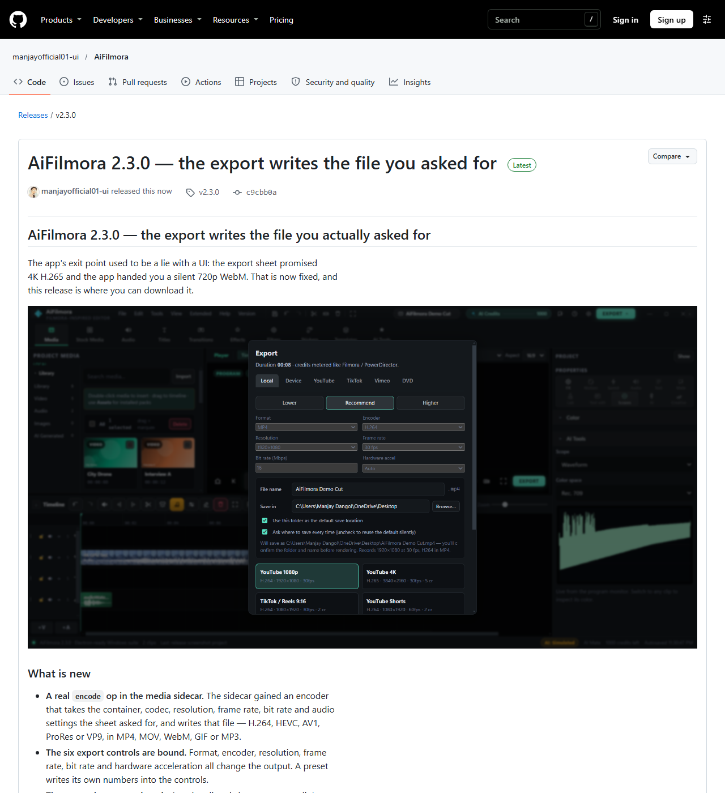
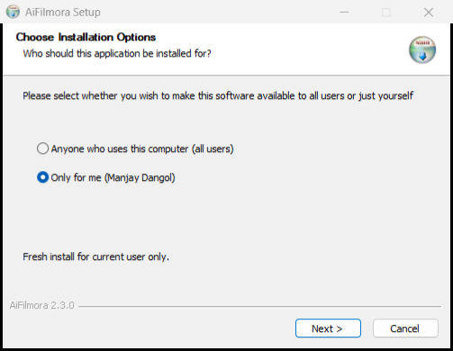
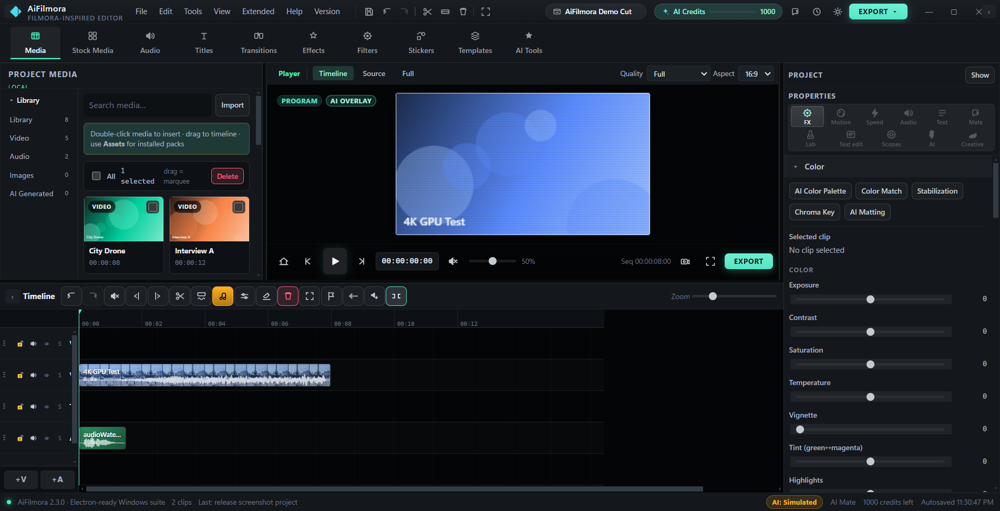
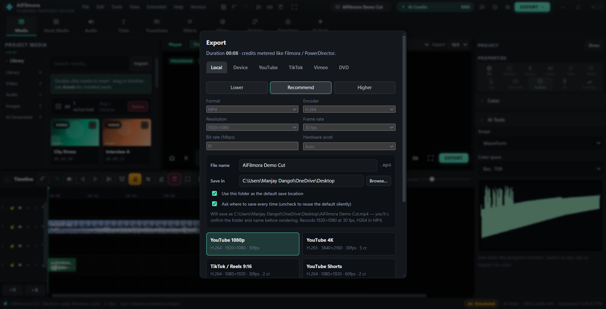

# Installing AiFilmora

**AiFilmora 2.3.0** · Windows-first AI video editor suite
Author: **Manjay Dongol** · [github.com/manjayofficial01-ui/AiFilmora](https://github.com/manjayofficial01-ui/AiFilmora) · MIT licensed

---

## What you are installing

AiFilmora is an **Electron desktop app**. In 2.3.0 the desktop build ships with
**FFmpeg 6.1.1 and ffprobe bundled inside it**, so you do **not** have to
install FFmpeg yourself — the app can import MXF/MKV/ProRes, transcribe, and
export a real MP4/H.264 file out of the box.

| | |
|---|---|
| **System requirements** | Windows 10 (1809+) or Windows 11 · 64-bit · 4 GB RAM · 600 MB free disk |
| **You must install first** | Nothing. No Node.js, no Python, no FFmpeg. |
| **Licence** | MIT — see [LICENSE](LICENSE) |

---

## Step 1 — Get the installer

Go to the **Releases** page:

> **https://github.com/manjayofficial01-ui/AiFilmora/releases**



You will find two downloads:

| File | What it is | Size |
|---|---|---|
| `AiFilmora-<version>-win-x64.exe` | The **installer** — installs to your machine, creates a desktop and Start-menu shortcut | ~188 MB |
| `AiFilmora-<version>-portable-win-x64.exe` | The **portable build** — one file, no installation, run it from anywhere | ~152 MB |

> **Tip:** prefer the portable file if you cannot install software (locked-down
> work machines, a USB stick, a shared PC). It is the same application.

---

## Step 2 — Run the installer

Double-click `AiFilmora-2.3.0-win-x64.exe`.

The installer asks who it is for. Choose **"Only for me"** unless you want the
app for every account on the machine:



Press **Next >**, then **Install**.

> **If Windows shows a blue "Windows protected your PC" warning:** this
> installer is not code-signed yet, so Defender SmartScreen does not recognise
> the publisher. Click **More info**, then **Run anyway**. (Or right-click the
> file → **Properties** → tick **Unblock** → **Apply**.) The build is open
> source and the binary is the one produced by `npm run dist` in this
> repository.

---

## Step 3 — Launch it

When the install finishes the app starts by itself. After that you can launch
it from the **desktop shortcut** or from **Start → AiFilmora**.

Here is the editor, with a real video and a real audio file on the timeline —
note the **filmstrip** drawn from the actual frames and the **waveform**
decoded from the actual audio:



On first run you may be asked a couple of questions about the workspace. You
can change all of them later under **Settings**.

---

## Step 4 — Check that the encoder is there

Click **Export** in the top-right corner.



If the sheet says **Format: MP4** and **Encoder: H.264**, the bundled FFmpeg
was found and the app will write a real MP4 file.

If it says *"This build has no encoder, so it records a WebM preview"*, then
the bundled binaries did not load. See
[Troubleshooting](#troubleshooting) below.

---

## Step 5 — Export a file

1. **Import** a clip — click **Import** in the media panel (top-left).
2. **Drag it** onto the timeline, or double-click it.
3. Set the format you want in the export sheet: container, codec, resolution,
   frame rate, bit rate, hardware acceleration.
4. Click **Start render**.

The app renders the timeline in real time, mixes the audio bus into the
picture, and then hands the file to FFmpeg. When it finishes you get the
exact file you asked for — the extension in the sheet is the extension the
file really has.

---

## Step 6 — (Optional) Install Whisper for transcription

The speech engine is **not** bundled, because the model file is large and
belongs to you. To get real word-level transcripts:

1. Download a [whisper.cpp](https://github.com/ggerganov/whisper.cpp) Windows
   build (`whisper-cli.exe`).
2. Download a model (`ggml-base.bin` is a good starting point) from
   [ggerganov/whisper.cpp/models](https://github.com/ggerganov/whisper.cpp#models).
3. Set two environment variables before starting AiFilmora:

```powershell
$env:AIFIMORA_WHISPER          = "C:\whisper\whisper-cli.exe"
$env:AIFIMORA_WHISPER_MODEL    = "C:\whisper\models\ggml-base.bin"
```

Without them the transcript panel shows a **labelled sample** rather than
pretending to have transcribed anything.

---

## Running from source (developers)

You only need this if you want to change the code.

```powershell
git clone https://github.com/manjayofficial01-ui/AiFilmora.git
cd AiFilmora
npm install       # also fetches the bundled ffmpeg / ffprobe
npm start         # opens the desktop app
```

Other useful commands:

```powershell
npm run web       # serves the app in a browser at http://127.0.0.1:5173
npm run dist      # builds the Windows installer + portable exe into dist/
node verify-all.cjs 'docs\product\POST-CHANGE.md'   # the full regression suite
```

**The browser build has no FFmpeg.** It is fine for everything except the
final export, which falls back to a clearly-labelled WebM preview.

---

## Troubleshooting

| Symptom | What it means | What to do |
|---|---|---|
| *"This build has no encoder, so it records a WebM preview"* | The bundled FFmpeg was not found | See below |
| *"Windows protected your PC"* | The installer is not code-signed | **More info → Run anyway** |
| The app opens but the preview is black | The project has no media on the timeline | Import a clip and drag it onto the timeline |
| The export says the sound track could not be recorded | The audio bus produced no frames | Try again; the app falls back to a picture-only file rather than failing |
| I want **my own** FFmpeg to be used instead of the bundled one | The bundled copy is preferred, so the app behaves the same everywhere | Set `AIFIMORA_FFMPEG` / `AIFIMORA_FFPROBE` to your binaries, or set `AIFIMORA_DISABLE_BUNDLED_TOOLS=1` to make the search fall through to `PATH` |

### The encoder was not found

The bundled binaries live in the installed folder at:

```
<install folder>\resources\app.asar.unpacked\node_modules\ffmpeg-static\ffmpeg.exe
<install folder>\resources\app.asar.unpacked\node_modules\ffprobe-static\bin\win32\x64\ffprobe.exe
```

If those two files are present, the sidecar should find them. If they are
missing, the install is incomplete — re-run the installer.

To point the app at a different FFmpeg:

```powershell
$env:AIFIMORA_FFMPEG  = "C:\ffmpeg\bin\ffmpeg.exe"
$env:AIFIMORA_FFPROBE = "C:\ffmpeg\bin\ffprobe.exe"
```

---

## Where your project is stored

The project is autosaved into your browser profile's local storage, and the
backup ring keeps recent snapshots next to it. Exported files go wherever you
choose in the export sheet — nothing is uploaded anywhere.

---

## Uninstalling

**Settings → General → Uninstall** from the app's own menu, or:

- **Control Panel → Programs and Features → AiFilmora → Uninstall**, or
- run `Uninstall AiFilmora.exe` in the install folder.

---

## More

- [README.md](README.md) — what the app does
- [docs/product/SIDECAR.md](docs/product/SIDECAR.md) — how the FFmpeg sidecar works
- [docs/product/APP-037-EXPORT.md](docs/product/APP-037-EXPORT.md) — how the export works
- Issues and feature requests → [github.com/manjayofficial01-ui/AiFilmora/issues](https://github.com/manjayofficial01-ui/AiFilmora/issues)
