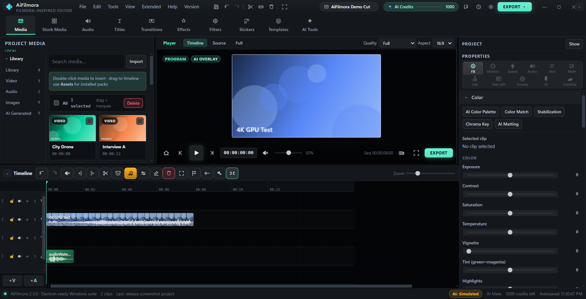
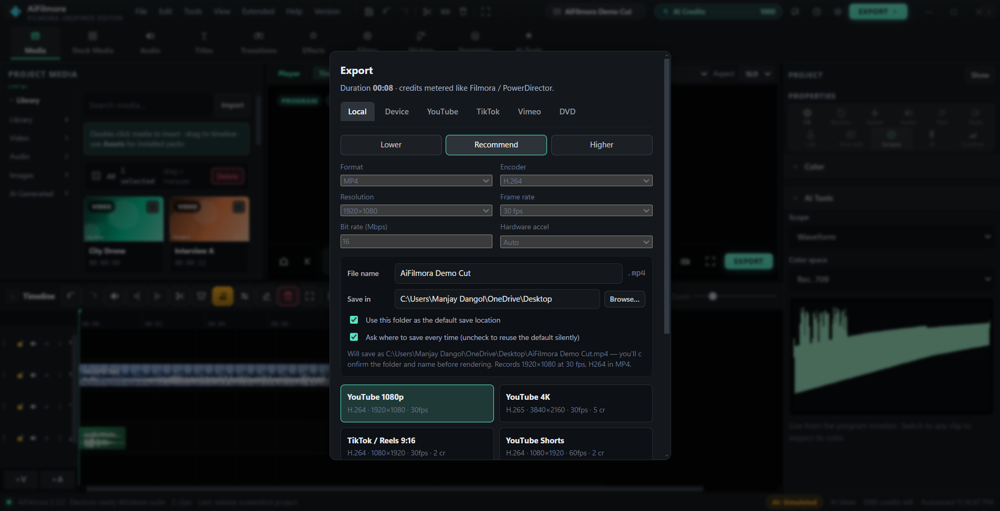
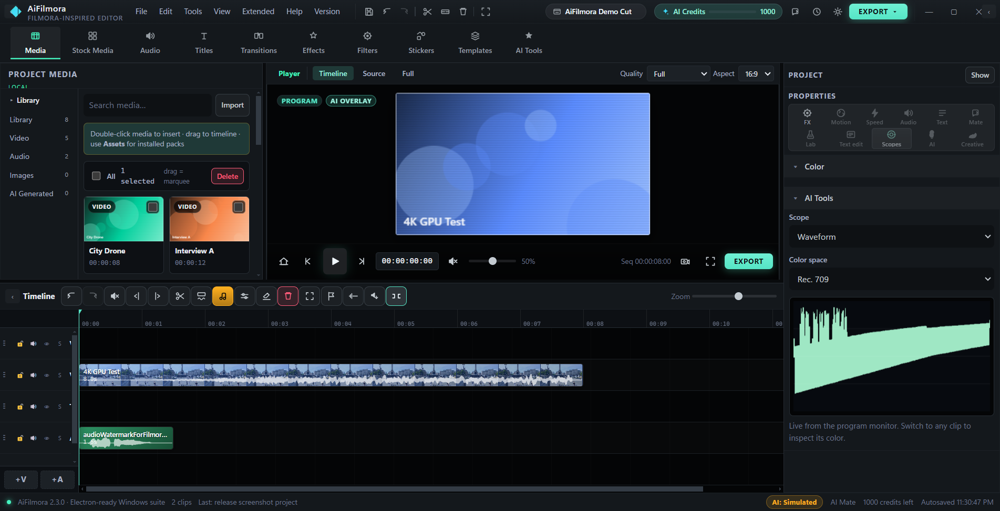
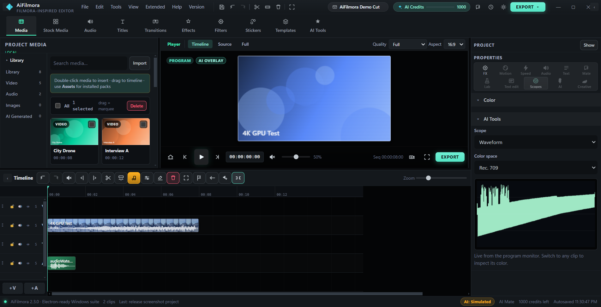
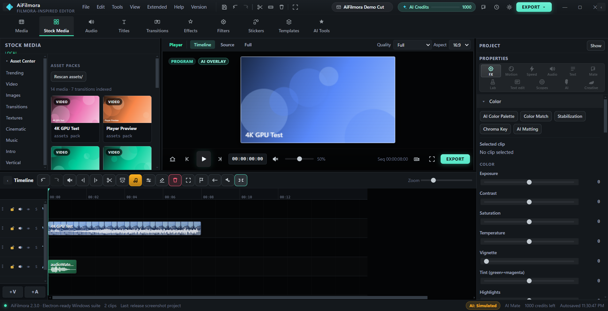

# AiFilmora

[](LICENSE)
[](https://github.com/manjayofficial01-ui/AiFilmora/releases)
[](https://github.com/manjayofficial01-ui/AiFilmora/releases)
[](https://electronjs.org)

**Windows-first AI video editor suite** that integrates cutting-edge features researched from Filmora 15, Adobe Premiere Pro, Descript, DaVinci Resolve, Final Cut Pro, CapCut, and PowerDirector (2025–2026).

> **Version 2.3.0** — the export now writes **the file you asked for**. FFmpeg 6.1.1 and ffprobe **ship inside the app**, so there is nothing to install: pick MP4/H.264 (or HEVC, AV1, ProRes, VP9, GIF, MP3) in the export sheet and you get that file.



---

## Table of contents

- [Install](#install)
- [Screenshots](#screenshots)
- [What it does](#what-it-does)
- [Running from source](#running-from-source)
- [Verify](#verify)
- [Author](#author)
- [License](#license)

---

## Install

**Windows 10 / 11, 64-bit.** No Node.js, no Python, no FFmpeg — the desktop
build bundles its own FFmpeg.

1. Download from **[Releases](https://github.com/manjayofficial01-ui/AiFilmora/releases)**
   — `AiFilmora-2.3.0-win-x64.exe` (installer) or
   `AiFilmora-2.3.0-portable-win-x64.exe` (no installation).
2. Run it. Choose **"Only for me"**, then **Next → Install**.
3. Launch from the desktop shortcut.

**Full step-by-step guide with screenshots → [INSTALL.md](INSTALL.md)**

---

## Screenshots

Every screenshot below is the **real application**, captured from the running
Electron build with the bundled FFmpeg sidecar live.

### The export sheet — six controls, all of them bound



Format, encoder, resolution, frame rate, bit rate and hardware acceleration
all change the file. The extension shown is the extension the file will
really have — the app never shows you `.mp4` and hands you a WebM.

### The timeline tells the truth



The **filmstrip** is sampled from the real frames of the real file, and the
**waveform** is decoded from the real audio track. Neither is a drawing.

### Live colour scopes



Waveform, RGB parade, vectorscope and histogram, computed live from the
program monitor.

### The built-in asset packs



262 fonts, 25 3D LUTs, 76 audio presets, 150 animation presets, 192 filter
looks and 15 canvas ports of Filmora's own GPU shader transitions.

---

## What it does

| Area | Features |
|---|---|
| Timeline | Multi-track timeline, drag/trim/split, vertical track moves, snap, **Ctrl+wheel zoom**, middle-mouse pan, **real filmstrips and waveforms** |
| Panels | **Draggable resizers** for library, inspector, timeline height (double-click to reset) |
| Preview | Canvas program monitor with live FX, styled titles, transition preview |
| **Export** | **A real `encode` op in a media sidecar** — MP4/MOV/WebM/GIF/MP3 in H.264, HEVC, AV1, ProRes or VP9, at the resolution, frame rate and bit rate you choose, with an **audio mix bus** so the file has a sound track. Without an encoder the app says so and writes a labelled WebM preview instead. |
| Text | Title/lower-third/sticker presets, font/color/position, fade/slide/typewriter/pop |
| Transitions | Dissolve, dip, wipe, slide, zoom, flash, glitch — ◇ on cuts + Transitions tab |
| AI Mate | Built-in edit actions + **live chat** when an OpenAI-compatible provider is set |
| AI Providers | OpenAI, OpenRouter, Groq, DeepSeek, Mistral, Together, Ollama, LM Studio, custom |
| GenAI Lab | Multi-model picker (Veo / Runway / Kling / Seedance) + credit metering |
| Transcript | Paper edit, filler strip, sequence from selection |
| Effects | Color + tint/highlights/shadows/sharpness, LUT intensity, Magic Mask (feather/invert), Voice Isolation + strength, Denoise, Super Scale, Stabilization, Face Mosaic, Object Remover, Smart Conform |
| Motion | Per-clip **transform + keyframes** (position, scale, rotation, opacity, anchor) driven from the inspector |
| Color Scopes | Live **waveform / RGB parade / vectorscope / histogram** from the program monitor |
| Color tools | **Auto Enhance**, **Color Match** (from selected), LUT intensity — strengths in Preferences → Color |
| Stabilize | Filmora-style stabilization with smoothness (canvas crop-zoom pass) |
| Beat Sync | Auto-detect beats (real Web Audio or BPM sim) + **Beat Options** (highlight every N / offset / all-vs-highlights) + **Beat Montage** |
| Preferences | Full **Settings dialog** — General, Folders, Editing, Performance, Playback, Audio, AI, Captions, Scopes, Beat, Color, LUTs, Export, Project, Storage, Backup, Appearance, Keyboard |
| Project Settings | Editable **current** project W/H/FPS + aspect presets (16:9 / 9:16 / 1:1 / 21:9 / 4K) |
| Clipboard | **Copy / Paste / Duplicate / Ripple Delete** wired to shortcuts + context menu |
| Context menu | Right-click a clip: split, copy, paste, duplicate, reverse, freeze, Beat Sync/Options, Stabilize, Vocal Remover, Color Match, AI Extend, compound, properties (18 items) |
| Track controls | **Lock / mute / hide / solo** per track; player honors hidden & solo |
| Snap | Smart snap to clip edges, markers, beats, playhead (then 0.5s grid) |
| Backup | Autosave timer + backup ring + crash-recovery prompt + exit snapshot |
| Chroma key | Enhanced key with color / similarity / smoothness / **edge feather / spill suppression** (canvas pass) |
| Split screen | Side / PiP / 2×2 layout modes on clips |
| Audio | Volume + fades + LUFS normalize + **EQ presets, denoise strength, hum/wind removal, Audio Stretch, Vocal Remover (vox/inst split)** |
| AI Music/TTS | **AI Music Generator** (mood/tempo/duration → A2) + **Text-to-Speech voiceover** (system preview → A1) |
| AI Extend | Filmora 15-style forward extension (+1–5s, ripple) |
| Thumbnail | **AI Thumbnail Creator** — 1280×720 PNG with title bar |
| Face/Object | **Face Mosaic** privacy blur + **Object Remover** Magic Box flag |
| Speed ramps | Filmora presets: Montage, Hero Moment, Bullet Time, Jumper, Flash In/Out |
| Scene Detect | Splits video clips using Preferences → AI → scene threshold |
| Auto Duck | Lowers music under voice using Preferences → Audio → ducking |
| Captions | Dynamic templates (basic/pop/karaoke/outline) + bilingual + configurable style + **.srt export** (panel + shortcut + AI Mate) |
| Fullscreen | ⛶ button + **F**; zoom-to-fit **Shift+Z**; snapshot **C** |
| Recent | File → **Recent** project library (local names + timestamps) |
| LUTs | Import **Filmora-style .cube 3D LUTs** — listed in FX LUT dropdown |
| Asset Pack (1.5.0) | **25 real Filmora .CUBE LUTs** (32³ trilinear + intensity, visual browser with live-graded thumbs) · **76 Filmora audio presets** rebuilt as a Web Audio rack (13 families, real param ranges, audition) · **150 animation presets** (82 in / 55 out / 13 loop) · **192 filter looks** · **48 text styles** · **98 text art** · **86 motion presets** · **10 masks** · **4 transitions** with real thumbnails & preview video |
| Fonts (1.6.0) | **262 faces / 186 families** from `assets/Fonts` in a **visual picker** — every tile set in its own typeface, searchable, faces fetched lazily on scroll (87 MB costs nothing until a tile is visible) |
| Colour (1.7.0) | **29 Filmora colour presets** (Blockbuster, Lomo, Old Film, Polaroid…) graded **per pixel** from Filmora's own `.conf` numbers — white balance, exposure, vibrance, highlight/shadow, black/white levels, 8-band HSL, vignette. Replaces the `ctx.filter` approximation; stacks with a LUT |
| Pan & Zoom (1.8.0) | **6 Filmora presets** driven by the real keyframed crop curves in `configs/PanZoom/*.conf` — four tracks (X, Y, W, H) as normalised fractions, so Zoom in narrows to 2× while staying centred. Tile previews show start vs end frame |
| Audio transitions (1.9.0) | **7 crossfade curves** from `resources/transition` — Constant Power, Constant Gain, Exponential, Logarithmic, De-aliasing, Fade, Simple Mix. Fades were a linear ramp; Constant Power now holds perceived level flat through a cut |
| Shader transitions (2.2.2) | **15 canvas ports of Filmora's real GPU shaders** from `asset/resources/wfx_effect/Transition/*.frag` — Cross Zoom, Push, Drop Bands, Erase Wipe, Linear Wipe, Pinwheel, Pixelate, Roll Clockwise, Round Zoom Out, Skew Split, Doorway, Whirl, Evaporate (real mask PNG), Fade Black/White with the sine curve from the `.frag` source. Grouped in the Transitions panel with a "Shader" rail filter |
| Creative | **Filmora 15 round 3**: Pen Tool (paths + trim-path), Text Path, Animated Charts (CSV → bar/line/pie), Audio Visualizer (bars/wave/circle), Video Chapters (+ progress bar + YouTube timestamp export), Subtitle Extractor, Voice Changer presets, AI Voice Cloning, AI SFX Generator, Auto Sync, Multi-Clip (batch) editing, Motion Blur, Flicker Removal, Import Subprojects, 32-bit float audio pipeline setting |
| Keyframes | Keyframed motion with per-property tracks and a scrubbable timeline |
| Persistence | localStorage autosave, layout + AI config + preferences, demo seed |

---

## Running from source

```powershell
git clone https://github.com/manjayofficial01-ui/AiFilmora.git
cd AiFilmora
npm install     # also fetches the bundled ffmpeg / ffprobe
npm start       # the desktop app
npm run web     # or a browser preview at http://127.0.0.1:5173
npm run dist    # build the Windows installer + portable exe
```

The **browser build has no FFmpeg**. Everything works except the final
export, which falls back to a clearly-labelled WebM preview.

---

## Verify

```powershell
node verify-sidecar.cjs   # 118 checks — the sidecar, the encoder, a real FFmpeg run
node verify-wave0.cjs     # 54 checks — the export sheet, the mix bus
node verify-export22.cjs  # 9 checks  — the export writes a real file
node verify-all.cjs 'docs\product\POST-CHANGE.md'   # the whole suite
```

The sidecar suite runs the encoder against the **real bundled FFmpeg 6.1.1**:
it builds a source from `lavfi`, probes it, and re-encodes it into
MP4/H.264, MP4/HEVC, WebM/VP9, MP4/AV1, MOV/ProRes, a two-pass GIF and an MP3
— each one written and then **probed back**, with the codec, the resolution
and the audio track asserted from the file rather than from the request.

---

## Author

**Manjay Dongol**

- GitHub → **[github.com/manjayofficial01-ui](https://github.com/manjayofficial01-ui)**
- Project → **[github.com/manjayofficial01-ui/AiFilmora](https://github.com/manjayofficial01-ui/AiFilmora)**

---

## License

MIT © 2026 Manjay Dongol — see **[LICENSE](LICENSE)**.

```
MIT License
Copyright (c) 2026 Manjay Dongol
```

You are free to use, copy, modify, merge, publish, distribute, sublicense and
sell copies of this software, and to permit persons to whom the software is
furnished to do so, subject to the conditions of the MIT licence.

---

## Notes on honesty

AiFilmora tries hard not to pretend. Where a capability is simulated, the UI
says so — the transcript without a speech engine is labelled *"Sample
transcript — no speech engine is available on this machine"*, and the export
without an encoder is labelled *"Quick preview export · WebM"*.

The generative-AI tier (GenAI Lab, AI Mate, AI Music, AI Thumbnails) is still
**simulated** with production-like UX — jobs, credits, transcripts. The
architecture is ready to swap in real `faster-whisper`, ONNX Runtime and cloud
GenAI APIs through the Electron UtilityProcess, but that work is not finished.
The FFmpeg side, by contrast, is **real**: the encoder, the probe and the
transcoder are the real binaries.
